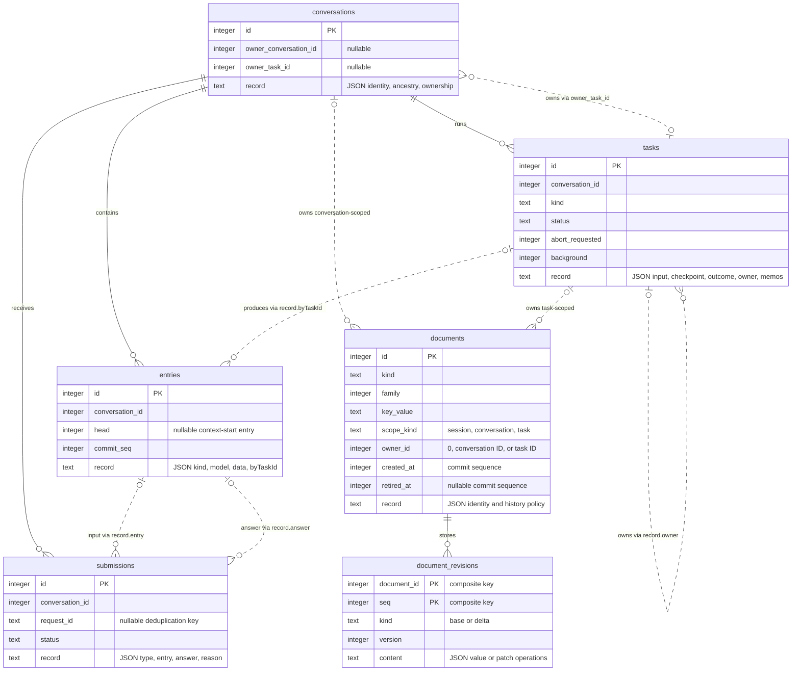
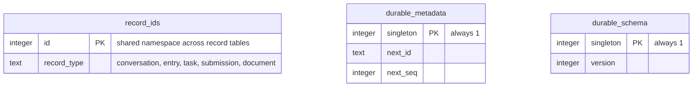

# Database data model

Both `chats/<cwd-hash>.sqlite` and `repos/<github-host>/<owner>~<repo>.sqlite` under Pronto's state directory use this schema. Each database is one Durable session. A repository session holds independent audit conversations for several PRs. Earlier hash-named repository databases in `repos/` and old per-PR databases in `audits/` remain untouched and are not imported.

The default state directory is `~/.local/state/pronto`. `PRONTO_STATE_DIR` overrides it; otherwise an absolute `XDG_STATE_HOME` selects `$XDG_STATE_HOME/pronto`. See [Credentials and audit storage](README.md#credentials-and-audit-storage) for path selection and locking. The adjacent `.lock` files hold ownership locks, not conversation data.

## What each table is for

The tables separate conversation history, recoverable execution and structured application state.

### Conversation history

#### `conversations`

Identifies each conversation and records any parent or owning task.

In the chat database, one conversation continues across restarts. In an audit database, each new assessment attempt gets its own conversation.

The row does not contain messages or agent configuration. Those live in entries and documents.

#### `entries`

Stores the append-only history of a conversation: user input, system instructions, model responses, tool calls and tool results.

Entries can also store bookkeeping records that are not sent to the model. An audit recheck is an entry with kind `app.review-audit-recheck`. It records that evidence was checked again without adding another user message.

### Recoverable execution

#### `submissions`

Tracks whether an admitted request has been answered.

A submission connects a request to its input entry and eventual answer entry. Its status distinguishes queued, placed, done and unanswered requests.

The optional `request_id` provides deduplication within a conversation. Audits use it to avoid submitting the same saved evidence twice after a restart.

A submission answers: "What is the status of this request, and where is its answer?"

#### `tasks`

Tracks the individual pieces of work needed to answer a request.

One submission can require several model generations and many tool calls. Each is a task with saved input, execution state and an eventual outcome. An `app.review-audit-controller` task belongs to each assessment conversation. It admits the saved evidence using a stable request ID, waits for the submission and saves completion, the PR's cache pointer and any verdict-publication task in one commit.

While unfinished, a task stores the checkpoint needed to resume. It can also store temporary durable memos, such as a fetched GitHub file. Memos are removed once the task's outcome is decided; committed tool-result entries remain.

A task answers: "What operation was running, and where did it reach?"

A terminal task is finished, but its outcome may be completed, failed, aborted, orphaned or faulted.

### Structured state

#### `documents`

Identifies structured state belonging to the session, a conversation or a task.

The table stores the document's identity, owner and history policy, not its actual value. Document kinds include:

| Document kind | Purpose |
| --- | --- |
| `pi.agent` | Model, instructions and enabled extensions |
| `pi.provider` | Persistent provider-session identity |
| `pi.live` | Current run and partial generation or tool output |
| `pi.inbox` | Queued inputs |
| `pi.usage` | Token and cost totals |
| `app.review-audit` | Saved evidence, accepted assessment and inspected file URLs |
| `app.review-audit-identity` | Evidence-and-policy fingerprint and policy hash |
| `app.review-audit-runs` | One family member per PR: current attempt, controller task, restart intent and cache pointer |
| `app.submitted-audit-reviews` | One family member per PR: submitted audit reviews used to skip duplicate writes |
| `app.audit-publication-requests` | Explicit publication choices admitted with an assessment, and its publication task IDs |
| `app.audit-publications` | One family member per PR: immutable pending publication intents and delivery state |
| `app.audit-reassessments` | Pending fresh assessments for approvals whose head or base changed |

#### `document_revisions`

Stores the values of those documents.

A revision is either a complete JSON value (`base`) or a set of changes (`delta`). Durable reconstructs the current value by applying subsequent deltas to the latest base.

For example, a recheck can save a small delta that updates only `latestSuccess.lastCheckedAt`.

These revisions are not necessarily a permanent edit history. Documents configured to retain only their latest state may discard older revisions. Rewindable documents retain history needed for reads at an earlier commit.

### Storage bookkeeping

#### `record_ids`

Reserves IDs across all record types.

Conversations, entries, tasks, submissions and documents share one ID namespace within the database. Conversation IDs are therefore not consecutive: other records receive the intervening IDs.

#### `durable_metadata`

Tracks the next record ID and next commit sequence.

A commit sequence identifies an atomic batch of saved changes. Several records written together can share that sequence. It is not a timestamp.

#### `durable_schema`

Records the SQLite schema version.

Durable uses it to determine which database migrations are needed. This is separate from the version of an individual document's JSON format.

## Core tables

Relationships are logical references enforced by Durable, not declared SQLite foreign keys. Dashed lines highlight conditional ownership or references stored inside JSON records.



## Bookkeeping tables

These 3 tables sit alongside the core tables. `record_ids` reserves IDs across conversations, entries, tasks, submissions and documents.



## How the tables work together

For a new audit:

```text
conversations       identifies the assessment attempt
documents           identifies its evidence and report state
document_revisions  stores the evidence, then the accepted report
submissions         tracks the assessment request
tasks               coordinates the assessment and runs the model and tools
entries             preserves their messages and results
```

For an unchanged-evidence recheck, there is no new conversation, submission or model task. It appends a receipt to `entries` and updates the cache document through `document_revisions`. Both changes share one atomic commit.

## Reading the model

- `documents.owner_id` is polymorphic: its meaning depends on `scope_kind`. Session documents have no conversation or task owner.
- A document's value is the latest `base` plus subsequent `delta` revisions, not `documents.record`. Use Durable's snapshot API to read the reconstructed value.
- Submission-to-entry and task-to-entry links live inside JSON records.
- Audit snapshots, reports and cache state are document kinds, not extra tables.
- Rechecks are `entries` with kind `app.review-audit-recheck`. They also update `latestSuccess.lastCheckedAt` in that PR's session-scoped `app.review-audit-runs` family member.
- Commit sequences are not timestamps. Changes saved in the same atomic commit share a sequence.

The audit document definitions are in [`auditor.ts`](auditor.ts). Publication tasks and receipts are in [`publication.ts`](publication.ts). Webhook task and queue definitions are in [`webhook-queue.ts`](webhook-queue.ts).

## Audit database contents

Each repository has one database at `<state-directory>/repos/<github-host>/<owner>~<repo>.sqlite`, shared by the CLI and chat command across working directories. The host directory is the percent-encoded, lower-case GitHub hostname; the filename uses the lower-case base-repository owner and name, separated by `~`. The host and repo components distinguish origins and repositories, while excluding PR numbers and fork head names. One process owns the database; its shared harness can run independent PR audits concurrently. Earlier hash-named repository databases in the root of `repos/` are left untouched and are not imported. The first audit using a readable name starts a fresh database. The coding conversation remains separate in `<state-directory>/chats/<cwd-hash>.sqlite`.

Serve mode first saves accepted webhook work in the repository database. Its `app.webhook-audit` task belongs to the root conversation and starts at a `dispatch` checkpoint. The session-scoped `app.webhook-queue` document records deduplication and pending PRs. Concurrent copies of a delivery ID cannot create duplicate tasks. Only verified, classified audit deliveries reach this admission boundary; raw payloads and secrets are not stored.

The in-memory queue only dispatches durable task invocations. It limits concurrency across repositories and never overlaps one PR. A task marks its PR running before calling the normal auditor. Requests for a waiting PR coalesce. Requests for a running PR save at most one rerun, using the original URL. Completion removes the pending entry or atomically replaces its task with a rerun task, dispatched behind other waiting PRs. Ordinary audit failures settle the intake task; transient queue-bookkeeping failures retry. Shutdown preserves the checkpoint, pending entry and rerun flag.

Startup recovery resets interrupted intake entries to waiting and repairs any missing or terminal task still referenced by a pending entry. It retains each repository harness while work drains, including repositories without assessment conversations. Intake and assessment recovery for the same PR share one execution. Delivery IDs remain after completion, but IDs older than the repository's last 1000 accepted IDs can be admitted again. This replaces the former process-local, server-wide window. Restart order across repository databases is not a persisted global FIFO.

Queue execution is at least once, not exactly once. An interrupted webhook can re-enter normal audit handling. Verdict publication has its own durable handoff, independent of webhook intake. GitHub writes and local submission receipts remain non-atomic.

Each newly admitted audit attempt creates an independent conversation. Its evidence, identity, controller task and PR controller pointer are saved together, before submitting work to the model. Restored model requests and remote file reads wait until their PR is selected and passes live merge-status and label checks. Deferred-provider jobs keep their opaque handles in generation-task poll checkpoints. The execution gate resolves each handle's owning conversation from those saved checkpoints before polling it; unselected jobs are neither polled nor resubmitted.

New snapshots omit marked Pronto comments, replies and submitted review bodies from any account. They are not stored separately or included in the model input or evidence fingerprint. Ordinary discussion and unmarked older reports remain in scope. Historical snapshots are not rewritten.

The application stores these logical documents, not separate tables for each kind:

| Document kind | Scope | Contents |
| --- | --- | --- |
| `app.webhook-queue` | Session | `recent`: last 1000 accepted delivery IDs in this repository. `pending`: PR-number map containing the original URL, current intake task ID, running flag and one rerun flag. Admission changes this document and creates any new task in one commit. |
| `app.review-audit` | Conversation | `snapshot`: PR details, pinned commits, comments, replies, thread states, changed files and patches. `report`: accepted findings assessments, initially `null`. `databaseMigration`: model classification (`migration`, `not-migration` or `uncertain`) and reason, initially `null` and absent in older reports. `inspected`: URLs of remote file ranges read by tools. |
| `app.review-audit-identity` | Conversation | `fingerprint`: evidence and policy hash. `policy`: model and auditor configuration hash. Older conversations may not have this document. |
| `app.review-audit-runs` | Session family, keyed by PR number as a string | `active`: latest admitted conversation ID. `controllerTask`: its durable controller task ID. `complete`: whether that attempt has settled, including failure or cancellation. `restartModel`: saved force-restart intent, otherwise `null`. `latestSuccess`: eligible cached conversation ID, fingerprint, publication time (`assessedAt`) and last evidence-check time (`lastCheckedAt`), otherwise `null`. |
| `app.submitted-audit-reviews` | Session family, keyed by PR number as a string | `reviews`: receipts for submitted audit reviews, keyed by verdict/head/review-type fingerprint. Each receipt contains `headSha`, `event`, `url` and `recordedAt`. |
| `app.audit-publication-requests` | Conversation | `choices`: explicit `apply`, `approve`, `allowUncertain` and `approveMigrations` booleans saved before assessment execution. `tasks`: publication task IDs by fingerprint. Resuming with explicit new choices admits them before waiting; startup uses saved choices, not new server flags. Legacy assessments without saved choices default to preview during recovery. |
| `app.audit-publications` | Session family, keyed by PR number as a string | `pending`: fingerprint map containing an immutable intent, current task ID, author, attempted flag and failure flag. The intent stores the explicit choices, target URL, head and base SHAs, selected review event, exact rendered body and fingerprint. |
| `app.audit-reassessments` | Session | `pending`: PR-number map containing the target, publication choices, original author and stale publication fingerprint. Entries survive until fresh evidence is admitted or a live skip completes. |

The session-scoped `app.submitted-audit-reviews` family is also keyed by PR number as a string. Its `reviews` map holds one receipt per submitted-review fingerprint. Each receipt stores `headSha`, review `event` (`COMMENT` or `APPROVE`), GitHub review `url` and `recordedAt`. The fingerprint is a SHA-256 hash of the head, review event and rendered verdict body, ignoring evidence-fetch times and trailing whitespace. It is separate from the assessment cache fingerprint.

`recordedAt` is the local receipt timestamp, not GitHub's `submitted_at` value. Earlier experimental receipt schemas are not migrated; an existing GitHub review without a receipt in this document can be submitted again.

Review submission receipts remain the local source of truth for duplicate prevention. They are shared across audit attempts, working directories, CLI, chat and GitHub accounts using this repository database. Previews create no receipt or publication task. External edits, deletions, dismissals and later review decisions do not change a saved receipt.

### Durable verdict publication

Skips caused by your authenticated account's existing approval of the current head only log the reason and create no publication task or receipt. Other skips with `--apply` use the same publisher and receipt family as verdicts. The skip reason becomes a marked `COMMENT` review, fingerprinted by its body, head and review type. Its publication task belongs to the root conversation because no assessment conversation is created. Skipping leaves audit runs, saved evidence and cached assessments unchanged. Previews create no publication task or receipt.

For a fresh assessment, the controller atomically saves successful completion, cache state and an `app.publish-audit-review` task through `tx.createTask()`. Explicit choices are saved with evidence admission, so a crash before controller completion cannot lose the handoff. For a cache hit, the recheck entry, `lastCheckedAt` and publication handoff share a transaction. Neither path needs another model assessment to publish. A matching receipt suppresses task creation; a matching pending intent shares its task.

The publisher is a conversation-owned background task with a `publish` checkpoint. It cannot be cancelled by a model conversation restart. Its immutable input contains the complete publication intent. Before POST, it saves the authenticated author and an attempted flag in the pending document. This flag conservatively means GitHub may have accepted the request. After acknowledgement, it atomically saves the receipt, removes the pending entry and completes the task. A process crash leaves the live task resumable. A request failure leaves the intent pending and the task failed; startup creates a replacement delivery task, preserving the original intent and attempt state. A later explicit `--apply` can also retry it.

Serve startup discovers pending publications even without pending webhook work or an unfinished assessment. It retains their repository harnesses and resumes publication directly, without rerunning live audit admission or the model. CLI and chat recover publications when opening the targeted repository. Normal audit completion waits for its publication tasks; shutdown interrupts invocations but leaves their durable state. Failed publications are reported and retained for another startup or explicit apply, rather than retried in a tight loop.

On a saved attempted publication, the publisher lists all review pages before another POST. It accepts only a review matching the saved author, head SHA, review state, exact body and `<!-- pronto:publication:<fingerprint> -->` marker. A match restores the receipt without posting, even if an approval's head has since changed. Otherwise a retry still performs the normal approval head/base checks. Lookup failures stop the delivery rather than falling through to POST. If credentials now identify a different account, Pronto can reconcile the original author's review but refuses a new POST until that account is restored. Fresh intents do not adopt arbitrary remote reviews from another state directory.

If the approval head/base check finds changed commits, the publisher atomically removes the stale pending intent, saves an `app.audit-reassessments` request and completes with a null URL. It creates no submission receipt. The host starts a fresh assessment with current evidence and the saved publication choices, bypassing the cache. Serve mode uses normal durable intake and concurrency limits. Admission of the new assessment clears the matching reassessment request in the same transaction. A completed live skip also clears it. A crash before either step leaves the request discoverable on startup; a later crash resumes the newly admitted assessment. Other publication failures retain the original delivery intent.

This is not exactly-once publication. GitHub's `POST /repos/{owner}/{repo}/pulls/{pull_number}/reviews` does not document a client idempotency key; Pronto does not send or rely on an `Idempotency-Key` header. A crash or lost response can leave a review in flight or not yet visible when reconciliation runs. Edits, deletions or dismissals before receipt recovery can also prevent a match. Retrying after an empty successful lookup can therefore create a duplicate. Keep the state directory and inspect the PR after ambiguous failures. Durable's SQLite backend uses WAL with `synchronous=NORMAL`: it protects against process crashes, not loss of the newest commits after host or power failure.

See [How findings are stored](#how-findings-are-stored) for the report structure, finding fields and relationship between sources and finding counts.

Once the input is placed, the conversation transcript also contains the full snapshot as a user message. Committed model responses and tool results follow it. Remote file excerpts appear in file-tool results; this is not a local PR checkout. Accepted assessment arguments appear in the assistant's `report_review_assessment` call. That tool's result is an acknowledgement, while the accepted assessment is mirrored in `app.review-audit.report`. Rejected report proposals can also appear in the transcript.

Expect these changes across invocations:

| Event | Database effect |
| --- | --- |
| Accepted webhook | Atomically save its delivery ID and pending intent; create an `app.webhook-audit` task, or coalesce into waiting work or one saved rerun. Commit before HTTP `202`. |
| New audit after a cache miss | New conversation, evidence snapshot, identity and controller task; then submission, model and tool records, and an accepted report if successful. Older conversations remain stored. |
| Resume an unfinished audit | Same conversation and snapshot. The stable `review-audit:<snapshot.id>` request ID avoids a duplicate submission. Recovery updates task state and can add further model and tool entries. |
| Reuse an unchanged assessment | No new conversation, submission or assessment. Atomically append an `app.review-audit-recheck` entry, update `lastCheckedAt` and admit any explicit publication task. The recheck records the fingerprint, snapshot ID and fetch window. Original evidence and report remain unchanged. |
| Force a restart | Save restart intent, cancel that PR's unfinished work if present, then create a new conversation when fresh evidence is admitted. Keep the cancelled conversation's existing evidence and transcript. |
| Failed attempt | Keep any admitted conversation and its partial history. The report may remain `null`; the previous successful cache is not replaced. |
| Skip a PR with `--apply` | Skips caused by your authenticated account's approval only log the reason. Other skips save the reason as an immutable `COMMENT` publication intent and a root-owned background task, unless already recorded. Save the usual receipt after publication. No assessment is created or changed. |
| Post a verdict with `--apply` | Save immutable intent and publisher task at completion or cache recheck. After acknowledgement or remote reconciliation, atomically save the receipt, remove the pending intent and complete the publisher. The completed assessment is unchanged. |
| Skip a locally recorded verdict | No new review submission receipt. A normal cache recheck can still append its own evidence-check receipt and update `lastCheckedAt`. |
| Preview | No publication task or submission receipt. The assessment and its cache can still be saved normally. Earlier explicitly authorised pending writes can still recover. |
| Failed GitHub request | No new submission receipt. Keep the publication intent and attempt state for recovery. The assessment and cache remain saved. |
| Approval commits changed | Atomically retire the stale publication and save a reassessment request. Admit fresh evidence and a new controller before clearing the request. No stale approval POST or receipt. |

A report can be saved before its submission finishes. Its presence alone does not establish a successful audit. Before the initial evidence is admitted, an interrupted fetch leaves no new assessment conversation or snapshot. A webhook intake task or a force-restart intent may already be saved.

In SQLite, `conversations` identifies attempts, `entries` holds transcript and recheck records, `submissions` holds request IDs and status, and `tasks` holds execution state. Tool memos support recovery while a task is live; they are removed when its outcome is decided. `documents` identifies application and built-in `pi.*` documents. Their JSON values are stored in `document_revisions` as bases or deltas. Use Durable's snapshot API to read a materialised value rather than treating the latest delta as the whole document.

For read-only inspection with Node's built-in SQLite, use the hostname directory and readable database filename:

```sh
STATE_DIR="${PRONTO_STATE_DIR:-${XDG_STATE_HOME:-$HOME/.local/state}/pronto}"
DB="$STATE_DIR/repos/<github-host>/<owner>~<repo>.sqlite" node --input-type=module <<'JS'
import { DatabaseSync } from 'node:sqlite';
const db = new DatabaseSync(process.env.DB, { readOnly: true });
try {
  const queries = [
    `SELECT id FROM conversations ORDER BY id`,
    `SELECT id, conversation_id, status,
            json_extract(record, '$.requestId') AS request_id
     FROM submissions ORDER BY id`,
    `SELECT id, json_extract(record, '$.kind') AS kind, key_value, scope_kind, owner_id
     FROM documents WHERE retired_at IS NULL ORDER BY id`,
    `SELECT id, conversation_id, json_extract(record, '$.kind') AS kind
     FROM entries ORDER BY id`,
  ];
  for (const query of queries) {
    console.log(query);
    console.table(db.prepare(query).all());
  }
} finally {
  db.close();
}
JS
```

Conversation IDs are numeric database identities, not PR numbers. These application documents retain their latest value per scope; they are not a complete history of every document edit. Separate older audit conversations still retain their snapshots and reports.

## How findings are stored

There is no `findings` table. Findings live in the JSON value of the conversation-scoped `app.review-audit` document. The `documents` table identifies that document; `document_revisions` stores its value as a base and subsequent deltas. Use Durable's snapshot API to read the reconstructed value.

The structure is defined in [`auditor.ts`](auditor.ts):

```text
app.review-audit
├── snapshot
│   └── comments[]          original sources, authors, URLs and thread states
├── databaseMigration       PR-level classification, or null before acceptance
│   ├── status              migration | not-migration | uncertain
│   └── reason              classification and its basis
├── report[]                one assessment per source, or null before acceptance
│   ├── commentKey          links to snapshot.comments[].key
│   └── findings[]          one or more findings
│       ├── summary         short title
│       ├── status          addressed | outstanding | uncertain | not-actionable
│       ├── reason          assessment and its basis
│       ├── evidence[]      supporting URLs
│       ├── nextStep?       what needs to happen next
│       └── awaiting?       GitHub login of the person who acts next
└── inspected[]             file URLs inspected during assessment
```

A source is an inline comment with its replies, a PR-level comment or a non-empty review summary. Its key includes its kind and GitHub ID, such as `inline:101`, `comment:202` or `review:303`.

The host requires exactly one assessment per supplied source. Each assessment contains at least one finding. A review summary can contain a substantive concern and informational boilerplate, classified separately:

```json
{
  "commentKey": "review:303",
  "findings": [
    {
      "summary": "External key policy remains a deployment prerequisite",
      "status": "addressed",
      "reason": "The author documented the external policy requirement. No key-policy fix or deployment verification is claimed.",
      "evidence": ["https://github.com/owner/repo/pull/42"]
    },
    {
      "summary": "Change overview and review boilerplate",
      "status": "not-actionable",
      "reason": "The remaining review summarizes the implementation without requesting another change.",
      "evidence": ["https://github.com/owner/repo/pull/42#pullrequestreview-303"]
    }
  ]
}
```

Finding counts include every item in every assessment's `findings` array, including `not-actionable` items. They count findings, not sources. For example, 5 sources can produce 6 findings when one source contains 2 findings. The terminal shows both totals and gives each finding its own numbered block, repeating the source information underneath. These numbers are local to the printed report, not stored finding IDs.

Findings have no separate database ID. Each belongs to a source through its parent assessment's `commentKey`. Author, source URL and GitHub thread state remain in `snapshot.comments`, rather than being copied into each finding. Thread resolution describes the source thread; it is not a finding status.

`nextStep` and `awaiting` are optional schema fields. The auditor is instructed to supply both for `outstanding` and `uncertain` findings, and the host rejects those findings if `awaiting` is missing. Older saved reports may omit these fields; the renderer uses a generic next step and `unknown` ownership where needed.

The database-migration classification is saved alongside the findings in the same report-acceptance transaction. It is independent of finding statuses and counts. By default, only `not-migration` permits approval, subject to the findings policy and explicit action flags. Migration, uncertain or missing classifications block approval without suppressing the audit report or verdict comment. `--approve-migrations` bypasses this block for the current invocation without changing the saved classification or cache. See [Approve clean audits](README.md#approve-clean-audits).

The overall verdict and status counts are calculated from the saved findings when printing. They are not additional report fields. Finding-first rendering uses the existing saved assessments without a database migration or a new model assessment. See [Finding-first terminal output](README.md#finding-first-terminal-output) for an example.
